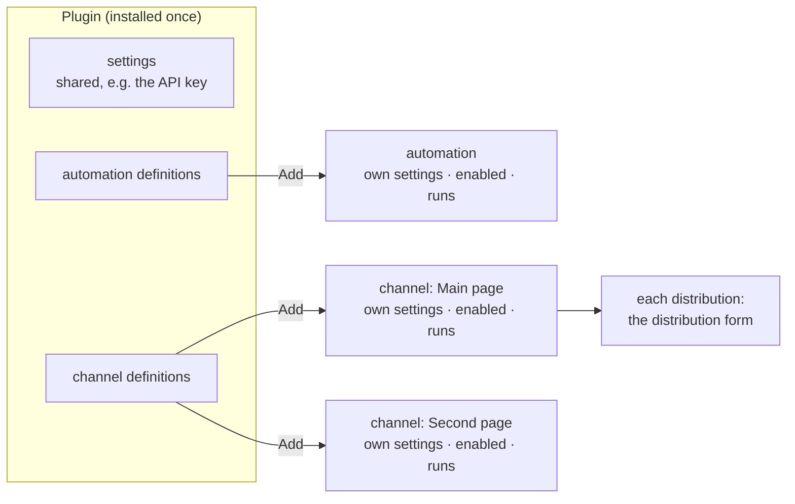
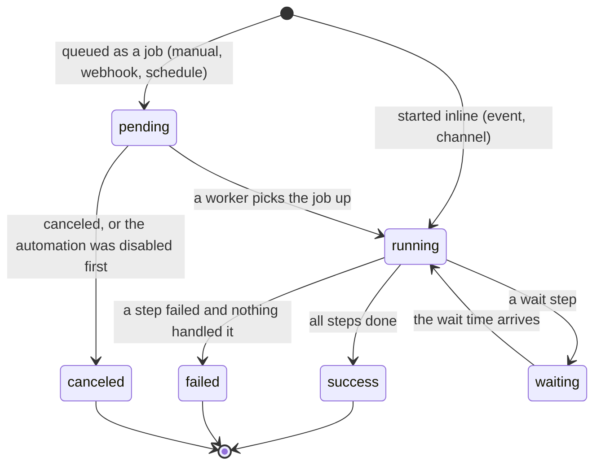
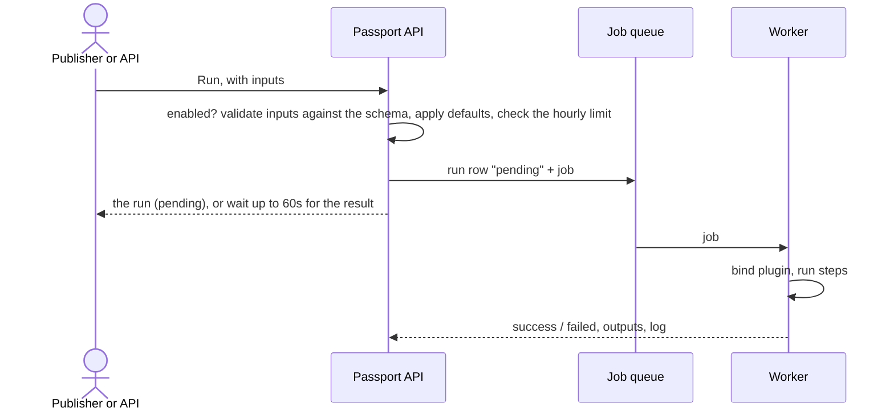
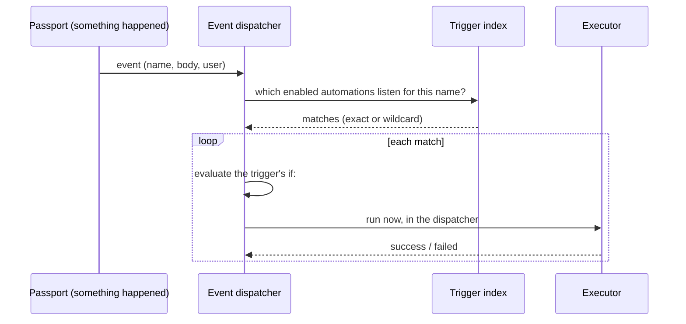
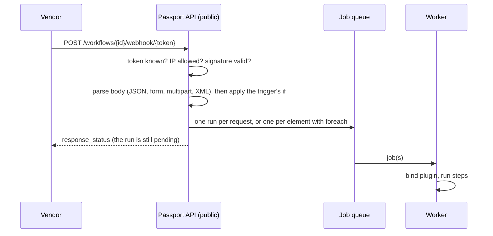
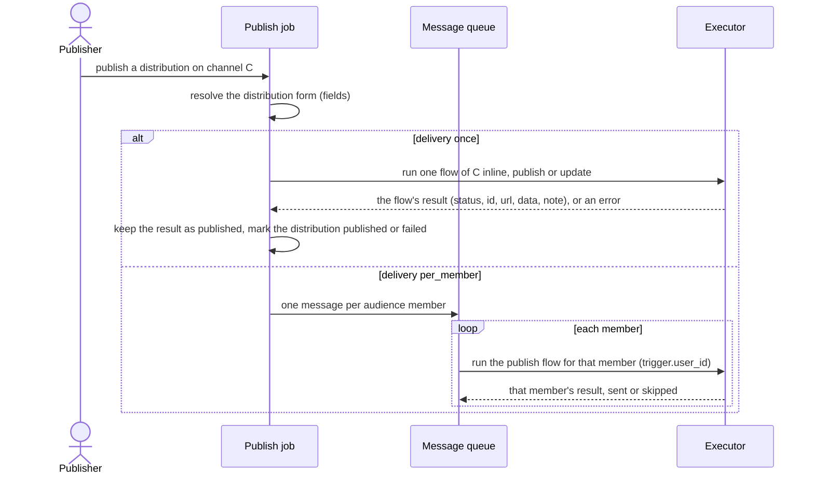

# Passport Plugin Development Guide

Internal. For Passport operators who build plugins, and for Claude and Scout
when they build one.

This guide defines **Workflow v2**: the five kinds of definition a plugin is
made of, how each is written, and how the engine runs them. It is the
reference Passport Studio, the back office and the engine are built against.

| Chapter | |
|---|---|
| This page | Concepts, how the engine runs things, what changed from v1, working with Claude |
| [1. Project and manifest](guide/01-project-and-manifest.md) | Layout, `plugin.yaml`, versions, references, `requires`, dependencies |
| [2. The field schema](guide/02-field-schema.md) | Inputs, outputs, settings, forms and their layout |
| [3. Schemas](guide/03-schemas.md) | Schema files, event schemas, the built-in `passport` schemas |
| [4. Actions](guide/04-actions.md) | Built-in actions, effect classes, writing a plugin action |
| [5. Automations](guide/05-automations.md) | Triggers, settings, inputs, outputs |
| [6. Channels](guide/06-channels.md) | The channel block, settings, the distribution form, and a channel's flows with the result each returns |
| [7. Steps and expressions](guide/07-steps-and-expressions.md) | Step kinds, errors, what a run can read, expression rules |
| [8. Functions](guide/08-functions.md) | Every inline function |
| [9. Files and binary data](guide/09-files-and-binary.md) | Assets, base64, `http.*` bodies |
| [10. Testing, review and release](guide/10-testing-review-release.md) | Check, dry run, sandbox, pushing a change, releasing |
| [11. Converting from v1](guide/11-converting-from-v1.md) | Mapping table and the Campaign Monitor walk-through |
| [Reference](reference/) | Built-in actions, events and schemas in full |

## Status

Written 14 November 2026 for Passport 2.3.0. This guide is the specification;
the engine and tools are being brought up to it. Until a part is built, the
table says so, and `passport-plugin check` is the judge of what your server
accepts today.

| Part | State on 16 November |
|---|---|
| v2 files (`plugin.yaml`, `automations/`, `channels/`, `actions/`, `schemas/`, `assets/`, `docs/`), the checks, the build (references pinned, dependencies copied in, the index entry) | Built |
| The field schema, form layout, and validation of what people type and what the engine produces ([chapter 2](guide/02-field-schema.md)) | Built |
| Plugin actions with declared inputs and outputs | Built |
| The plugin's settings as a form, with secrets kept apart | Built |
| The built-in `passport` schemas, the 2.3.0 functions ([chapter 8](guide/08-functions.md)), binary in `http.*` ([chapter 9](guide/09-files-and-binary.md)), the signed-webhook check | Built |
| Installing a v2 plugin; adding automations and channels with their own settings; tools; the connection test | Built |
| Effect classes on built-ins ([4.2](guide/04-actions.md)) | Built |
| Choices loaded from an action ([2.8](guide/02-field-schema.md)) | Built |
| The distribution form ([6.4](guide/06-channels.md)) | Built in the engine; the admin's distribution page does not show it yet |
| Extensions, previews and the paragraph editor ([5.7](guide/05-automations.md#57-extensions), [2.6](guide/02-field-schema.md#the-paragraph-editor)) | Built |
| Channel flows: `publish`, `update`, `delete`, `preview` and `status` in the channel file, each with a fixed result, and `published` ([6.5](guide/06-channels.md#65-the-flows)); `channel.delivery` and `channel.audience` in place of `mode` and `requires_audience` ([6.2](guide/06-channels.md#62-the-channel-block)) | Specified 16 November; not built. Until it is, `passport-plugin check` refuses the examples in chapter 6 |
| Templates a plugin ships and the channel template menu ([6.8](guide/06-channels.md#68-templates)) | Built, in review; the admin's template menu is not built |
| Protected assets, virtual assets, audiences on the steps that create assets, and audience ranking ([9.7](guide/09-files-and-binary.md#97-protected-and-virtual-assets)) | Built |
| Passport Studio for publishers, direct installs, the community registry ([1.7](guide/01-project-and-manifest.md#17-registries-and-where-a-plugin-can-go)) | Not built |
| The publisher's admin pages for v2 plugins | Built: Plugins pages, forms with choices, the Extensions menu. Not yet checked against a live site |
| Passport Studio: the new workbench, help-page editor, Form tab and Test panel | Built |
| Passport Studio: the Design surface and the form designer | Not built |
| External Node.js actions (`uses:`), and the 2.3 format this guide replaces (`plugin.yml`, `workflows/`, `recipes/`) | Node actions removed; a `plugin.yml` project still builds and installs as before |

## Concepts

### The five kinds

A plugin is a folder of YAML files. There are five kinds of definition.

| Kind | What it is | File |
|---|---|---|
| **Plugin** | The bundle that is built, reviewed, released and installed. Holds the others, and the settings they share | `plugin.yaml` |
| **Schema** | A named shape of data: an action's input or output, an event's body | `schemas/<name>.yaml` |
| **Action** | One reusable operation with declared inputs and outputs. The engine has built-in actions; a plugin adds its own, made of steps | `actions/<name>.yaml` |
| **Automation** | A trigger (manual, event, webhook, schedule) and the steps to run when it fires. An automation marked as an **extension** has no trigger: a person runs it on one record (an article, a member), from that record's page | `automations/<key>.yaml` |
| **Channel** | A place a distribution can be published to: Spotify, a Facebook page, a LinkedIn page | `channels/<name>.yaml` |

An automation never defines a channel, and a channel is never started by a
trigger: it runs when a distribution on it is published, updated, deleted
or previewed, or when its status is asked for. Each of those five requests
has its own **flow** in the channel file: named steps that end in a result
whose shape Passport defines. Only `publish` is required. A channel with no
`update` flow cannot change what it has sent, and one with no `delete` flow
cannot take it back ([6.5.11](guide/06-channels.md#6511-permanence)).

### Definitions, and what a publisher adds

A plugin provides automation and channel **definitions**. Installing the
plugin starts nothing. On the plugin's page in the admin, the publisher
**adds** an automation or a channel from a definition, gives it a label,
fills in its settings and enables it.



A definition says whether it may be added once (the default) or many times
(`multiple: true`). Two Facebook pages are one channel definition added
twice.

What the publisher added is called simply *an automation* or *a channel*.
"Instance" always means a Passport instance, a publisher's site.

### Three levels of settings

| Level | Declared in | Filled in | Example |
|---|---|---|---|
| Plugin | `settings` in `plugin.yaml` | once, on the plugin's Settings tab | the ElevenLabs API key |
| Automation or channel | `settings` in that definition | once per added automation or channel | which Facebook page; which subscriber list |
| Distribution | `distribution` in a channel | each time a distribution is created on that channel | a summary; which voice |

Plus, for a single run: `inputs`, the values a manual run or a calling
automation supplies.

All of them are written in the [field schema](guide/02-field-schema.md) and
all become forms.

### What a run can read

| Name | Holds | Available in |
|---|---|---|
| `settings`, `secrets` | The plugin's settings and secrets | everything in the plugin |
| `automation.settings`, `automation.secrets` | This automation's own | automations |
| `channel.name`, `channel.label`, `channel.settings`, `channel.secrets` | This channel's own | channels |
| `fields` | The distribution form's values, resolved at publish | channels |
| `published` | What Passport kept from the last successful `publish` or `update` of the distribution: `id`, `url`, `data`, `status`, `at` | channels |
| `inputs` | What was supplied for this run; inside an action, the action's own inputs | manual runs, actions |
| `trigger` | What started the run | automations, channels |
| `steps.<id>.outputs` | What an earlier step returned | everywhere |
| `vars`, `outputs`, `loop`, `user`, `instance` | See [chapter 7](guide/07-steps-and-expressions.md) | everywhere |

### Who does what

| Who | Does |
|---|---|
| Operator, in Passport Studio | Builds the plugin, tests it on their own machine and on a sandbox, pushes it for review |
| Second operator | Reviews and approves; the back office releases it to the registry |
| Publisher, in the admin | Installs from the Registry tab, fills in settings, adds automations and channels, enables them |
| Publisher, with their own automations | Writes an automation in YAML from built-in actions only, under limits. See the Passport Automations Guide. None of those limits apply to a plugin |

## How the engine runs things

This is the internal picture. You do not need it to write a plugin, but it
explains timing, failure and limits.

Every run is a row in the run history with a status, the trigger, the inputs
(masked), each step's result and a log. The same executor runs every kind;
what differs is how a run starts and whether it is queued.

### Run lifecycle



- A **`wait`** step (top level only, up to 90 days) saves the run's state and
  schedules its return. `sleep` is a short in-place pause, up to 90 seconds.
- There are **no step-level retries**. Only the `http.*` actions retry, by
  their `retries` input. A failed run can be retried whole from the run
  history, with the stored trigger and inputs.
- Run history is kept 72 hours by default and up to 180 days with
  `retention:` on the definition. Waiting runs are never pruned.
- A site may start 500 runs in a rolling hour by default (an operator can
  change it). Channel runs are not counted and not limited.
- For a plugin's run the engine binds the plugin first: its settings and
  secrets become readable, the automation's or channel's own are added, and
  `http.*` may reach only the plugin's `allowed_hosts`.

### A manual run



Inputs are validated before anything is queued, so a bad value never becomes
a failed run. A caller may ask to wait up to 60 seconds and get the outputs
back; that is how previews and "Run" in the admin work.

An **extension** runs the same way. The request also names the record; the
API checks the caller may change it, loads it, and the run starts with the
record in hand.

### An event



- An event run starts **inline, in the event dispatcher**, not through the
  job queue. There is no pending state and no delay, and a slow automation
  holds that dispatcher worker for as long as it runs. Keep event automations
  short, or hand long work to `workflow.run` with `async: true`.
- There is **no de-duplication**. If Passport emits the same event twice, the
  automation runs twice. Make steps safe to repeat.
- Events emitted from inside a run are recorded but do not start other
  automations, so automations cannot trigger each other in a loop.
- A disabled automation is skipped silently.

### A webhook



The vendor gets its answer immediately; the work happens afterwards. A
webhook automation cannot return data computed by its steps.

### A schedule

Enabling an automation with a `schedule` trigger creates a recurring job.
Each tick starts a run exactly as a manual run does, with no inputs.
Disabling it removes the job.

### A channel



- **One request, one run, one flow.** The engine picks the flow from the
  request: `publish` when nothing of the distribution is live at the
  destination, `update` when it is published again while live, `delete`
  before the distribution is deleted, `preview` and `status` when the
  publisher asks. `trigger.action` carries the flow's name. A request whose
  flow the channel does not have starts no run
  ([6.5.11](guide/06-channels.md#6511-permanence)).
- A **`delivery: once`** channel runs inside the publish job, one time. If
  its `publish` or `update` run fails, the distribution is marked failed
  with the run's error. Use `workflow.fail` with a reason the publisher can
  act on. `once` says how often Passport hands the distribution over, not
  who may see it at the destination.
- A **`delivery: per_member`** channel's `publish` runs once per member of
  the audience, from the message queue, with the member as
  `trigger.user_id`; a run that times out is retried by the queue, and a
  failed run is a failure for that member only. Runs for one distribution
  are grouped together in the run history. Its other flows run once for the
  distribution, without a member.
- `delete` runs inside the delete, before the distribution's row is
  removed; a failed run keeps the distribution. `preview` and `status` are
  runs the caller waits on, up to 60 seconds, as for a manual run.
- **The flow's result is what Passport reads.** After the flow's steps its
  `returns` is evaluated and held to the engine's schema for that flow
  (`passport/schemas/channel.<flow>.result@1`); a result that does not fit
  fails the run. The result of a successful `publish` or `update` is stored
  with the distribution and handed to every later flow as `published`.
  Nothing else the run sets is copied back.
- `preview` and `status` flows may run only `control`, `read` and `external`
  actions; the engine refuses any other step in them.

## What changed from v1, and why

v1 grew six kinds of object in `passport-actions` with overlapping jobs and
no single description of any of them. Building features on them needed
knowledge of how the engine happened to behave.

| v1 | v2 | Why |
|---|---|---|
| **Blueprint** with event, manual, webhook or schedule triggers | **Automation** | Same thing with a clearer name; no more wrapper with two copies of `inputs` |
| **Blueprint** with a `distribution:` trigger | **Channel**, with a `channel:` block | A channel is not triggered; it has its own settings, a distribution form, and a flow for each request it answers. Hiding it inside a trigger hid all of that |
| **Recipe** (`includes:`) | **Action** in a plugin | Recipes had no declared outputs, unvalidated inputs, and their step ids leaked into the caller. An action has a contract |
| **Package** (`package.yml`) and **vendor plugin** (`plugins/<v>/plugin.yml`, `plugin.call`, `data_source`) | **Plugin** | Two half-overlapping ways to group and configure. One bundle, one settings model |
| **Schema** files, referenced but never checked | **Schema**, resolved and validated | A reference that nothing reads is documentation that rots |
| **Action** (Node.js, GitHub-Actions style, `uses:`) | removed | It ran third-party JavaScript on the server for the sake of compatibility nobody used. Everything real was already YAML on built-ins |
| Install-time values as workflow input defaults | Settings at three levels | Input defaults mixed "configure once" with "supply per run", and a package's settings were saved by rewriting workflow definitions |
| Free-text inputs with rules in the description | The field schema | A form can be built, and a bad value is refused before a run |
| One workflow per channel name, one install per package | Add a definition as many times as it allows | Two Facebook pages needed a copied blueprint |
| Unversioned, or a `v2/` folder | Semver in every file, one file per major | References can state what they need |
| Editor hints the engine ignores (`ui:` on the trigger) | A closed, documented set on the channel, plus the distribution form | The admin and the Studio can rely on them |

What did **not** change: the executor, the step kinds, expressions, the
built-in actions, and every v1 workflow already installed, which keeps
running as it is.

## Working with Claude

Scout in Passport Studio is the supported way to build a plugin by asking for
it: it knows this guide, checks and dry-runs what it writes, and shows every
change before it is saved. Claude Code works too, in a checkout of this
branch, given the right context.

### What to give it

1. Open the checkout of this branch as the working directory. `CLAUDE.md` at
   the root loads the rules automatically.
2. Point it at the plugin: "work in `plugins/<id>/`".
3. Give it the vendor's API documentation for the calls involved, as a link
   or pasted text. It should not guess endpoints.
4. Say what the publisher should see: which settings, which automations and
   channels, what each form asks for.

### A prompt that works

```
Build a Passport v2 plugin in plugins/acme-mail/.

Read docs/PLUGIN-DEVELOPMENT-GUIDE.md, then chapters 1, 2, 4 and 5 under
docs/guide/. Use plugins/campaign-monitor/ as the model.

It connects a publisher's site to Acme Mail (API docs: <link>).

Plugin settings: API key (secret), account id.
Actions: one per API call we use: subscriber.add, subscriber.remove, lists.get.
Automations:
  - "Add new subscribers to a list": on user.subscription.status.active;
    its own setting is the list, chosen from lists.get; may be added more
    than once.
  - "Remove canceled subscribers": on user.subscription.status.canceled.

Every form field needs a title and a description. Add a test case for each
automation under tests/. Run `passport-plugin check plugins/acme-mail` and
fix everything it reports before you stop. Do not write releases/ or
index.json.
```

### What it gets wrong without this guide

- Writes v1: `blueprint.yml`, `on: distribution`, `includes:`, `uses:`,
  `inputs` duplicated at two levels.
- Declares credentials as plain strings instead of `secret: true`.
- Puts choices in a description instead of an `enum`, and lists as
  comma-separated text.
- Invents built-in actions and functions. The lists in
  [reference/](reference/) and [chapter 8](guide/08-functions.md) are
  complete; if it is not there, it does not exist.
- Reads `inputs.x` for something that is a setting. Settings are
  `settings.x`, `automation.settings.x` or `channel.settings.x`.
- Writes a channel as one `steps:` list that branches on `trigger.action`,
  or records the link in `context`. A channel has flows (`publish`,
  `update`, `delete`, `preview`, `status`), and each ends in `returns`.
- Passes binary through an output. Binary is an asset or base64 text.

### Checking its work

`passport-plugin check <folder>` reports every problem with file and line.
`passport-plugin run <folder> --automation <key>` dry-runs with sample data
from `tests/`. Read the diff. Then test on a sandbox and push for review like
any other change; review by a second operator is not optional because an AI
wrote it.
